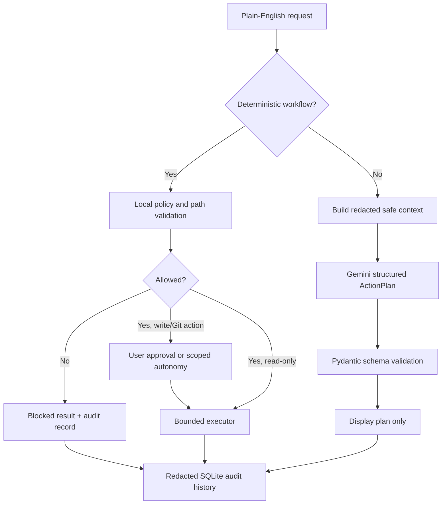

# Cmdora

Cmdora is a Windows command-line assistant for careful Git and workspace workflows. You describe
an intent in plain English; Cmdora either selects a deterministic supported workflow or asks Gemini
for a **structured plan only**. Local checks decide whether a command may run.

> Cmdora is a pre-alpha developer tool. Use it in a disposable repository while you evaluate it.

Terminal work is often slowed by remembering exact Git and PowerShell syntax. An LLM can help
translate intent, but it must not become an unrestricted shell authority. Cmdora keeps planning,
policy, approval, execution, and audit logging separate.

## Features

- Plain-English workflows for file creation, files modified today, Git status, commits, pushes,
  and explain-only Git questions.
- Gemini plans validated against strict Pydantic schemas.
- Workspace-constrained PowerShell execution with no user profile, a timeout, captured output,
  and Ctrl+C handling.
- Local command allowlist and explicit blocks for deletion, encoded PowerShell, secrets, remote
  downloads, package installs, remote changes, force pushes, and other unsafe operations.
- Per-repository constrained autonomy for safe reads, new allowed workspace files, and guarded Git work.
- SQLite audit history with secret redaction.
- Offline unit and integration tests, plus an opt-in live Gemini evaluation corpus.

## Architecture



Gemini receives only redacted request text and narrow repository metadata: workspace basename,
Git state, supported actions, and autonomy mode. It does not receive file contents, `.env` values,
tokens, SSH keys, personal paths, or complete Git diffs.

## Installation

Requirements: Windows PowerShell, Python 3.12+, Git, and [uv](https://docs.astral.sh/uv/).

```powershell
git clone https://github.com/indrasuthar07/Cmdora.git
Set-Location Cmdora
uv sync --all-extras
uv run Cmdora --help
```

## Gemini API key setup

Copy the example file and add your own key:

```powershell
Copy-Item .env.example .env
notepad .env
```

Set `GEMINI_API_KEY` in `.env`. The file is ignored by Git. You can also set the key only for the
current terminal session:

```powershell
$env:GEMINI_API_KEY = "your-key-here"
```

Gemini is needed only for requests that are not handled by a deterministic built-in workflow.

## Example commands

Run Cmdora from the repository you want it to operate on:

```powershell
Cmdora "list all files modified today"
Cmdora "what command shows my current git branch?"
Cmdora "create src/components/Button.js"
Cmdora "create src/components/Button.js" --dry-run
Cmdora "git status"
Cmdora "commit my latest changes with message add button component"
Cmdora "push my current branch"
Cmdora history --last 10
```

For a safe first run, use `--dry-run`; it shows the proposed deterministic command without
starting PowerShell.

## Autonomous mode

Cmdora defaults to approval mode for non-read-only actions. Enter `a` at an approval prompt and
confirm the additional warning to enable `git` autonomy for the current repository. Cmdora stores
that decision only in `.Cmdora/config.toml` inside that workspace.

```powershell
Cmdora "create src/utils/date.py" --autonomy git
```

Autonomy can run safe reads, new allowed workspace files, and permitted Git operations. It cannot
run arbitrary shell commands, delete files, read secrets, leave the workspace, force-push, or push
to protected branches such as `main` and `master`.

## Security model

Cmdora treats generated content as untrusted. It validates paths, classifies commands locally,
uses an allowlist, requires confirmation for state-changing actions, and records redacted results.
The local policy blocks destructive commands, obfuscated PowerShell, credential paths, `.env`
access, downloads, package installs, force pushes, branch deletion, and remote changes.

Audit data is stored at `%APPDATA%\CmdoraAI\history.db`; use `Cmdora history` to inspect it.
The audit redactor removes common API keys, bearer tokens, JWT-like strings, password values, SSH
private-key text, `.env` values, and the full home-directory path.

## Limitations

- Windows PowerShell is the supported shell; Cmdora does not support Bash, macOS, or Linux yet.
- Cmdora supports a deliberately small command set and will not execute arbitrary natural-language
  requests.
- Git pushes require a non-protected branch, configured `origin`, explicit push intent, and policy
  validation.
- Gemini availability, quotas, and model access are external dependencies for planning requests.
- The live Gemini evaluation is opt-in and has not been bundled with normal tests.

## Testing

```powershell
uv run pytest -q
uv run ruff check src tests scripts
uv run mypy
```

The suite includes temporary workspace and Git repositories, a local bare Git remote, real
PowerShell timeout/exit-code checks, policy tests, and a 61-prompt safety corpus. GitHub Actions
runs the offline checks on pushes and pull requests. Details and the opt-in live evaluation are in
[docs/evaluation.md](docs/evaluation.md).

## Roadmap

- Execute validated structured multi-step plans through the same policy gate.
- Add richer repository inspection and safe read-only workflows.
- Add cross-platform shell support.
- Add a reviewed public demo GIF/video and release artifact.
- Add CI coverage reporting and release automation.

## Contributing

1. Create a feature branch from `main`.
2. Keep the change focused and add tests for behavior changes.
3. Run the commands in [Testing](#testing).
4. Open a pull request describing the safety impact and verification results.

Never commit `.env`, API keys, generated local audit databases, virtual environments, or cache
directories.

## License

Cmdora is released under the [MIT License](LICENSE).
